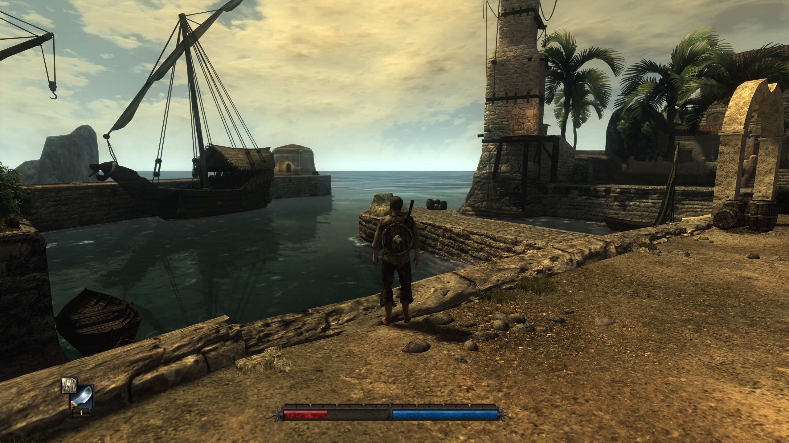
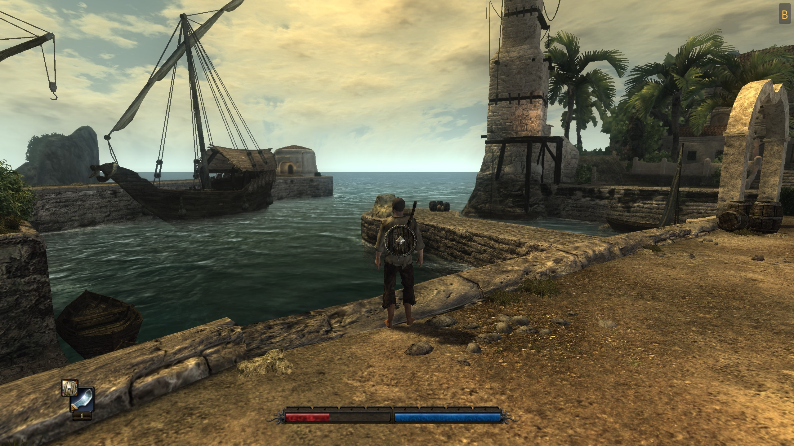

# risen-enhanced-graphics

A Vulkan renderer for **Risen Enhanced** (64-bit): a `d3d9.dll` next to `Risen.exe` that replaces the engine's graphics layer
(Vulkan 1.3, dynamic rendering). Work in progress, see [docs/PLAN.md](docs/PLAN.md).

[Image Comparison](https://www.diffchecker.com/image-compare/7Ttb27k6/)




## What you get

Everything is switched on or off in the in-game settings menu (press F11). Presets run from "Original" (the game's own look)
to "Ultra", so you can trade looks for speed.

- **Better water**: realistic reflections, moving ocean waves, foam where the sea meets the beach, and wet sand.
- **Better shadows**: softer, sharper and reaching further. With a ray-tracing graphics card they can be even more exact.
- **More realistic lighting** (needs a ray-tracing graphics card): light bounces around and colours nearby surfaces, and
  corners and crevices get natural darkening.
- **Sharper picture and more fps**: AMD FSR anti-aliasing and upscaling, and optional frame generation that shows extra
  frames in between for smoother motion.
- **See further**: trees and objects stay visible from a greater distance.
- **High frame rate fixes**: falling, climbing and thunder behave correctly at high fps.
- **Display options**: borderless or exclusive fullscreen, a frame rate limit, vsync and a performance display.

Your graphics card needs Vulkan 1.3. If you are unsure about the game's own look, the "Original" mode (System tab) switches
all of this off.

## Latest updates

- Smoother, less noisy ray-traced lighting.
- Sharper upscaling, with a new high-quality setting and better handling of thin things such as fishing nets.
- Held weapons and shields look better when upscaled.
- Frame generation for AMD cards, now stable when resizing the window or switching fullscreen.
- Updated AMD FSR to the newest version, with an optional FSR 4 for newer Radeon cards.
- An experimental "Full" mode where the new renderer draws the whole frame itself.
- Better error reporting for crashes, which helps bug reports.

New builds appear nightly on the [release page](https://github.com/kirides/rvk/releases/tag/nightly).

## Install

Download `risen-enhanced-graphics.zip` from the [nightly release](https://github.com/kirides/rvk/releases/tag/nightly) and unpack
it into `<Risen>\bin` (`d3d9.dll`, `rvk\config.toml`, `rvk\README.txt`). In game, F11 opens the settings overlay.

Files in `<Risen>\bin\rvk\`: `config.toml` (start configuration), `settings.toml` (player settings), `rvk.log`.

## Build

Visual Studio 2026 (C++ workload), CMake >= 3.25, [vcpkg](https://github.com/microsoft/vcpkg) with `VCPKG_ROOT` set.

```powershell
cmake --preset default
cmake --build build --config RelWithDebInfo
.\scripts\package.ps1      # optional: the release zip, into out\package
```

## Credits

- High fps gameplay fixes (falling, climbing, thunder; setting "High Fps compatibility (Vaana)" in the overlay's System
  tab): ported from [VaanaCZ's Risen FPS Patch](https://github.com/VaanaCZ/Risen-FPS-Patch) (VaanaCZ and Auronen).
